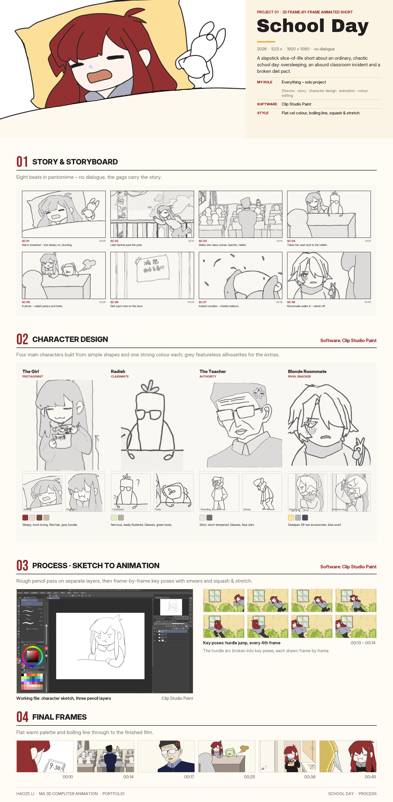

# Bournemouth Master's Animation Portfolio

**Haoze Li** · Portfolio for MA 3D Computer Animation, Bournemouth University

---

## Project 01 · School Day

*2D frame-by-frame animated short · 2026 · 52.5 s · 1920 × 1080 · no dialogue*

A slapstick slice-of-life short about an ordinary, chaotic school day: oversleeping, an absurd classroom incident and a broken diet pact.

| | |
|---|---|
| **Role** | Everything (solo project): director, story, character design, animation, colour, editing |
| **Software** | Clip Studio Paint |
| **Style** | Flat cel colour, boiling line, squash & stretch |

**Clip:** [school-day-clip-01.mp4](school-day/school-day-clip-01.mp4)
